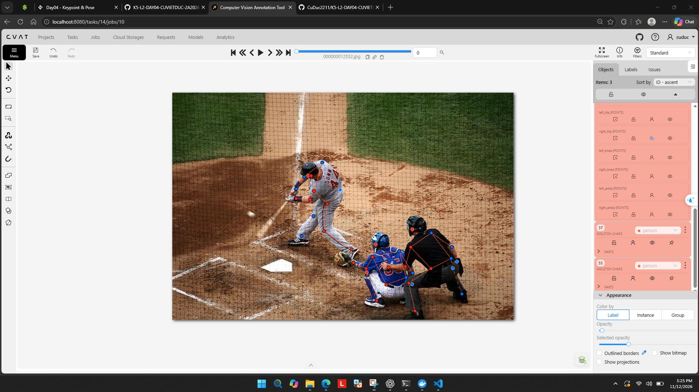
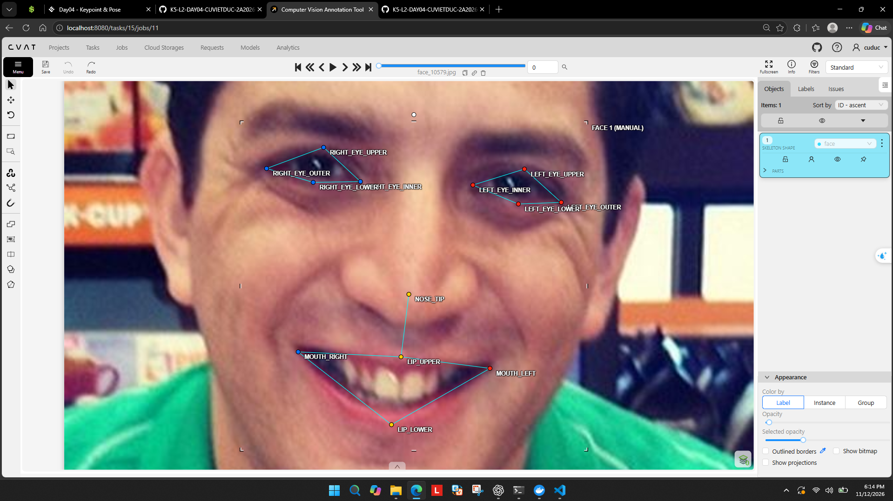
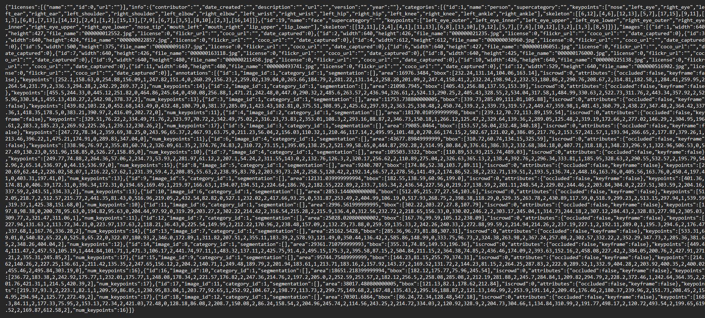
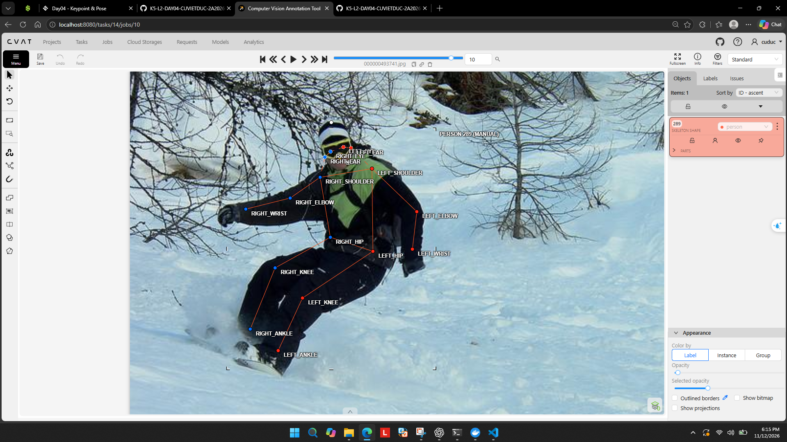

# Báo cáo cá nhân — CuVietDuc-2A202603042


Dữ liệu: 12 ảnh người COCO 2017 (Lin et al., 2014) và 8 ảnh khuôn mặt cắt từ ảnh COCO, theo danh sách `src/lab/pool.json`; chỉ dùng trong lớp.

## 0. Thông tin học viên

- Họ tên: Cù Việt Đức
- MSSV: 2A202603042
- Email: cuvietduc2203@gmail.com
- Link repository: https://github.com/CuDuc2211/K5-L2-DAY04-CUVIETDUC-2A202603042-KeypointPose/tree/main
- Phiên bản CVAT (Help → About): CVAT 2.74.1
- Máy: Windows 11 · RAM 16 GB · chạy CVAT chế độ đầy đủ. Dung lượng lưu trữ: khoảng 500 GB (không nhớ chính xác).
- Bộ ảnh (`src/exports/assignment.json` do `lab.py setup` tạo): có
- Giờ bắt đầu: 16:45
- Giờ kết thúc: 19:00
- Khoảng thời gian từ bắt đầu đến kết thúc: 135 phút; chưa phân bổ thời gian thực tế từng CP.

## 1. Kiểm tra label (CP0)

| Label | Kiểu | Số điểm | Tên điểm đúng bảng của lab? | Đúng thứ tự? | Số cạnh |
|---|---|---:|---|---|---:|
| `person` | Skeleton | 17 | Có, đối chiếu JSON với schema | Có, trong JSON xuất | 19 |
| `face` | Skeleton | 13 | Có, đối chiếu JSON với schema | Có, trong JSON xuất | 13 |

Mẫu `person` dựng theo người quay mặt về camera (các điểm `left_*` nằm bên phải khung mẫu)? [CẦN XÁC NHẬN bằng Label Constructor; JSON không xác nhận bố cục khung mẫu].

Cách đổi cờ `occluded` / `outside` cho **một điểm** trên phiên bản CVAT này (một câu):

Tôi chọn điểm cần đổi cờ và sử dụng các phím tắt O và Q trên CVAT. Đây là thao tác tôi đã dùng; chưa ghi lại cụ thể phím nào ứng với từng cờ.

## 2. Số lượng đã gán và thời gian (CP1, CP2)

| Nhóm ảnh | Số ảnh | Số skeleton đã gán | Số người dưới 60 px (không gán) | Số poster / gương / màn hình bỏ qua | Thời gian (phút) |
|---|---:|---:|---:|---:|---:|
| `easy` | 5 | 5 | Không ghi nhận | Không ghi nhận | Không ghi nhận |
| `occluded` | 3 | 5 | Không ghi nhận | Không ghi nhận | Không ghi nhận |
| `back` | 2 | 3 | Không ghi nhận | Không ghi nhận | Không ghi nhận |
| `small` | 1 | 2 | Không ghi nhận | Không ghi nhận | Không ghi nhận |
| `crowd` | 1 | 3 | Không ghi nhận | Không ghi nhận | Không ghi nhận |
| `faces` | 8 | 8 | — | Không ghi nhận | Không ghi nhận |

- Số ảnh người đã xong ở mốc phút 105: không ghi nhận.
- Thời gian thực tế (phút): CP1 không ghi nhận · CP2 không ghi nhận · CP3 không ghi nhận.
- Ảnh tốn thời gian nhất là ảnh nào, vì sao?

Các ảnh thuộc nhóm `crowd` và `back`, đặc biệt là người quay lưng và các tư thế vận động thể thao, gây khó khăn và tốn thời gian nhất khi xác định vị trí keypoint. Không ghi nhận riêng một ảnh tốn nhiều thời gian nhất.

Số liệu trong bảng được thống kê từ ZIP đã xuất và nhóm ảnh trong `pool.json`: tổng 18 skeleton người và 8 skeleton mặt. README nêu mục tiêu 20 người; cần đối chiếu số người thuộc diện phải gán trên ảnh thật trước khi xác nhận đủ đối tượng. “Không ghi nhận” không có nghĩa là 0.

## 3. Bảng ca khó (CP1, CP2)

Các ca dưới đây được ghi lại từ trải nghiệm gán nhãn của tôi. Tôi chưa ghi nhận chính xác bên trái/phải và số thứ tự đối tượng cho các điểm bị che ở hai ảnh người, nên không tự bổ sung thông tin đó.

| Ảnh | Người / mặt | Điểm | Cờ đã chọn | Phân vân giữa | Lý do chọn |
|---|---|---|---:|---|---|
| `000000012552.jpg` | Người có khớp bị che; chưa ghi số thứ tự | Đầu gối bị khuất; chưa ghi bên | 1 | Chưa ghi lại lựa chọn còn lại | Dù điểm bị che, tôi vẫn có thể phán đoán vị trí nên chọn v=1. |
| `000000012552.jpg` | Người có khớp bị che; chưa ghi số thứ tự | Khuỷu tay bị khuất; chưa ghi bên | 1 | Chưa ghi lại lựa chọn còn lại | Tôi cho rằng vẫn có đủ căn cứ để ước lượng vị trí khớp bị che. |
| `face_219250.jpg` | Mặt duy nhất trong ảnh | Các điểm mắt bị kính râm che | 0 | Chưa ghi lại lựa chọn còn lại | Tôi không thể phán đoán vị trí các điểm mắt một cách chắc chắn nên chọn v=0. |
| `000000106051.jpg` | Người bị che khuất; chưa ghi số thứ tự | Các điểm thuộc phần người bị che; chưa ghi tên cụ thể | 0 | Chưa ghi lại lựa chọn còn lại | Phần người lộ ra quá ít để xác định các điểm một cách chắc chắn nên chọn v=0. |

Các dòng phản ánh quyết định khi gán, không phải kết luận những quyết định đó đã đúng sau review. Cần xác định lại đối tượng và tên điểm cụ thể nếu bổ sung được.

## 4. Bảng tự review (CP3)

Chưa có kết quả tự review thực tế để ghi mã lỗi hoặc đánh dấu “ok”. Các ảnh dưới đây chỉ là danh sách đề xuất để thực hiện review, chưa tính là tám dòng review đã hoàn thành.

Đi từ ảnh cuối về ảnh đầu. 5 ảnh người (ít nhất 2 ảnh `back` hoặc `crowd`) và 3 ảnh mặt. Ít nhất 8 dòng, kể cả dòng `ok`. Ghi lỗi trước, sửa sau.

Mã lỗi dùng đúng một trong: `lr_swap`, `vis_flag`, `position`, `missing`, `extra`, `ok`.

| Ảnh | Người / mặt | Điểm cần kiểm tra | Mã lỗi | Ghi chú | Đã sửa? |
|---|---|---|---|---|---|
| `000000225138.jpg` | Người #1 | Gối, cổ chân; cảnh báo script | Chưa xác định | Chờ tự review | Chưa xác nhận |
| `000000163118.jpg` | Người #1 | Cổ chân; ảnh nhóm back, cảnh báo script | Chưa xác định | Chờ tự review | Chưa xác nhận |
| `000000106051.jpg` | Cần chọn đối tượng | Các điểm bị che; ca khó đã nêu | Chưa xác định | Chờ tự review | Chưa xác nhận |
| `000000022857.jpg` | Người #1 | Hướng người và trái/phải; ảnh nhóm back | Chưa xác định | Chờ tự review | Chưa xác nhận |
| `000000012552.jpg` | Người #1 và đối tượng của ca khó | Cổ chân theo cảnh báo; gối/khuỷu tay theo ca khó | Chưa xác định | Chờ tự review | Chưa xác nhận |
| `face_279764.jpg` | Mặt #1 | Cần kiểm tra thực tế | Chưa xác định | Chờ tự review | Chưa xác nhận |
| `face_219250.jpg` | Mặt #1 | Tám điểm mắt v=0; kính râm | Chưa xác định | Chờ tự review | Chưa xác nhận |
| `face_10579.jpg` | Mặt #1 | Các điểm mắt/miệng trong ảnh minh chứng | Chưa xác định | Chờ tự review | Chưa xác nhận |

Tổng hợp số lỗi theo mã:

| `lr_swap` | `vis_flag` | `position` | `missing` | `extra` | `ok` |
|---:|---:|---:|---:|---:|---:|
| Chưa thống kê | Chưa thống kê | Chưa thống kê | Chưa thống kê | Chưa thống kê | Chưa thống kê |

Điểm còn phân vân giữa `v = 1` và `v = 0` (ghi cả hai lựa chọn và lý do chọn):

Ở `face_219250.jpg`, tôi chọn v=0 cho các điểm mắt do kính râm che và không thể phán đoán chắc chắn vị trí. Chưa ghi nhận rõ hai lựa chọn phân vân hoặc kết luận sau review.

## 5. Kiểm file xuất và kết quả tự kiểm (CP4)

Đối chiếu JSON xuất bằng công cụ đọc dữ liệu và script gốc `src/check_submission.py`; không thay đổi annotation. Các dòng dưới đây là mẫu trong số 26 annotation đã kiểm tra.

| File | Người / mặt kiểm (ảnh, thứ tự) | Số phần tử `keypoints` | Visibility quan sát trong JSON | `num_keypoints` khớp? |
|---|---|---:|---|---|
| `CuVietDuc_persons.zip` | `000000012552.jpg`, #1, annotation ID 1 | 51 | 3 điểm v=0, 2 điểm v=1, 12 điểm v=2 | Có: 14 = 2 + 12 |
| `CuVietDuc_persons.zip` | `000000163118.jpg`, #1, annotation ID 12 | 51 | 3 điểm v=0, 2 điểm v=1, 12 điểm v=2 | Có: 14 = 2 + 12 |
| `CuVietDuc_faces.zip` | `face_219250.jpg`, #1, annotation ID 3 | 39 | 8 điểm v=0, 0 điểm v=1, 5 điểm v=2 | Có: 5 = 0 + 5 |

Theo quy ước lab, `occluded` tương ứng `v=1`, `outside` tương ứng `v=0`. Cần đối chiếu một điểm cụ thể trên CVAT với JSON để xác nhận thao tác cờ ban đầu; chỉ từ JSON không thể xác nhận việc chuyển cờ này. Có 67 điểm `v=0` vẫn giữ tọa độ khác `(0,0)`; script của lab chấp nhận trường hợp này và không tính là lỗi.

Hai job đã chuyển sang completed trên CVAT? Có, theo xác nhận của học viên; chưa kiểm tra trực tiếp trạng thái hiện tại từ CVAT trong lần kiểm ZIP.

Hai ZIP mới không kèm ảnh gốc, tên file đúng yêu cầu. Danh sách 12 ảnh người và 8 ảnh mặt khớp `assignment.json` đang có trên máy. Tên, thứ tự điểm và bộ cạnh khớp `keypoint_schema.json`. Tất cả 26 annotation có `num_keypoints` bằng số điểm `v>0`, visibility chỉ gồm 0/1/2; không có điểm `v>0` nằm ngoài kích thước ảnh.

Phần **TÓM TẮT** thực tế từ `src/check_submission.py`, chạy trên hai ZIP mới:

```text
----- TÓM TẮT (dán vào báo cáo mục 5) -----
- File person: CuVietDuc_persons.zip
  Số ảnh: 12 · số skeleton `person`: 18 · mỗi annotation 51 số
  Skeleton theo ảnh: 000000012552=3, 000000021235=1, 000000022857=1, 000000030960=2, 000000091637=2, 000000106051=2, 000000163118=2, 000000176000=1, 000000211458=1, 000000225138=1, 000000493741=1, 000000516902=1
  Cờ v: v=2 202 (66%) · v=1 45 (15%) · v=0 59 (19%)
  num_keypoints trung bình: 13.7
- File face: CuVietDuc_faces.zip
  Số ảnh: 8 · số skeleton `face`: 8 · mỗi annotation 39 số
  Skeleton theo ảnh: face_10579=1, face_178208=1, face_219250=1, face_279764=1, face_359139=1, face_449454=1, face_496353=1, face_79591=1
  Cờ v: v=2 96 (92%) · v=1 0 (0%) · v=0 8 (8%)
  num_keypoints trung bình: 12.0
- Ghi chú: 67 điểm v = 0 vẫn mang tọa độ cũ (CVAT 2.x xuất như vậy; chuẩn COCO ghi 0, 0). Không phải lỗi: điểm v = 0 bị bỏ qua khi huấn luyện và khi chấm.
- Số [LỖI]: 0 · số [CẢNH BÁO]: 3
Kết quả: ĐẠT (đọc lại từng cảnh báo ở trên)
```

Các `[CẢNH BÁO]` còn hiện trong kết quả kiểm tra:

| Ảnh / đối tượng | Nội dung cảnh báo | Kết luận sau review |
|---|---|---|
| `000000012552.jpg #1` | Cặp ankle ngược phía so với các cặp còn lại | Chưa xác nhận; cần xem lại trên CVAT |
| `000000163118.jpg #1` | Cặp ankle ngược phía so với các cặp còn lại | Chưa xác nhận; cần xem lại trên CVAT |
| `000000225138.jpg #1` | Cặp knee, ankle ngược phía so với các cặp còn lại | Chưa xác nhận; cần xem lại trên CVAT |

Script nêu khả năng đổi trái/phải hoặc tư thế tay/chân bắt chéo thật. Chưa có bằng chứng để ghi lý do giữ nguyên nhãn hay xác nhận lỗi `lr_swap`.

Ngoài cảnh báo do script phát hiện, cần đối chiếu hai vấn đề: tổng 18 skeleton người so với mục tiêu 20 trong README; mặt kính râm `face_219250.jpg` có 8 điểm v=0 và không có điểm v=1. Lý do học viên cung cấp: không thể phán đoán chắc chắn vị trí mắt sau kính râm. Chưa kết luận thiếu người hoặc đặt sai cờ; còn cần đối chiếu ảnh thực tế và quy tắc lab. Kết quả ĐẠT của script là kiểm định dạng và dấu hiệu lỗi, không phải kết quả chấm vị trí, OKS hoặc tự review.

## 6. Ảnh chụp màn hình

Đã bổ sung bốn ảnh chụp do tôi cung cấp. Trong đó có ba loại minh chứng phù hợp một phần/toàn bộ yêu cầu; còn thiếu ảnh Label Constructor.

1. Label `person` trong Label Constructor (đủ 17 điểm có tên): **chưa có**. Cần bổ sung `images/1_label_person.png`; ảnh skeleton trên ảnh thật không thay thế ảnh cấu hình label.

2. Người quay lưng trong cảnh thể thao `000000012552.jpg`, thấy skeleton và bảng parts/cờ:

   

   Ảnh có nhiều đối tượng; cần chọn rõ một điểm và hiển thị cờ nếu coach yêu cầu chứng minh trạng thái của điểm cụ thể.

3. Mặt `face_10579.jpg` đã gán 13 điểm, phóng to vùng mặt và mắt:

   

4. JSON xuất của task người:

   

   Ảnh JSON hiện có nhiều dòng chữ nhỏ; có thể bổ sung ảnh cắt vùng một annotation và phóng to để dễ đọc.

5. Minh chứng bổ sung: người vận động thể thao `000000493741.jpg`:

   

Nguồn ảnh: COCO 2017; ảnh khuôn mặt cắt từ ảnh COCO theo `src/lab/pool.json`.

## 7. Tự đánh giá

1. Lỗi/khó khăn tôi hay gặp nhất hôm nay, và cách tránh ở dự án thật:

Khó khăn tôi hay gặp nhất là xác định hướng người, đặc biệt khi người quay lưng hoặc thực hiện các động tác thể thao. Tôi chưa ghi nhận số lỗi đổi trái/phải đã xác nhận. .

2. Một quy tắc tôi đề xuất thêm vào guideline (kèm ảnh ví dụ nếu có):


3. Nhãn của tôi đi vào model ở đâu? Một lỗi thực tế đã sửa và ảnh hưởng của lỗi đó:


## 8. Khó khăn và lỗi kỹ thuật

- Khi chạy `python lab.py export` trong Ubuntu WSL, terminal báo `Command 'python' not found`. Hướng xử lý là dùng `python3 lab.py export` trong thư mục gốc dự án, theo hướng dẫn Ubuntu trong README. Tôi xác nhận đã chạy thành công lệnh export sau khi xử lý lỗi.
- Hai ZIP ban đầu kèm 12 ảnh người và 8 ảnh mặt nên script báo CHƯA ĐẠT với 2 lỗi. Hai ZIP mới `CuVietDuc_persons.zip` và `CuVietDuc_faces.zip` đã không kèm ảnh gốc; chạy lại script gốc cho kết quả ĐẠT, 0 lỗi và 3 cảnh báo. Cần tự review ba cảnh báo trước khi kết luận chất lượng nhãn.
- Không sửa JSON hoặc tọa độ annotation bằng tay trong quá trình kiểm tra file.

## Bonus

Không thực hiện bonus.

## 9. Tài liệu tham khảo và công cụ AI đã dùng

- Tài liệu bài lab: `README.md`, `RULES.md`, `SUBMISSION.md`, `RUBRIC.md`, mẫu báo cáo cá nhân; đối chiếu kỹ thuật với `src/keypoint_schema.json`, `src/lab/pool.json` và `src/check_submission.py`.
- Lin et al. (2014), Microsoft COCO: Common Objects in Context. Nguồn, giấy phép cụ thể của ảnh theo `src/lab/pool.json` trong dự án.
- ChatGPT/Codex: hỗ trợ giải thích lỗi lệnh 
